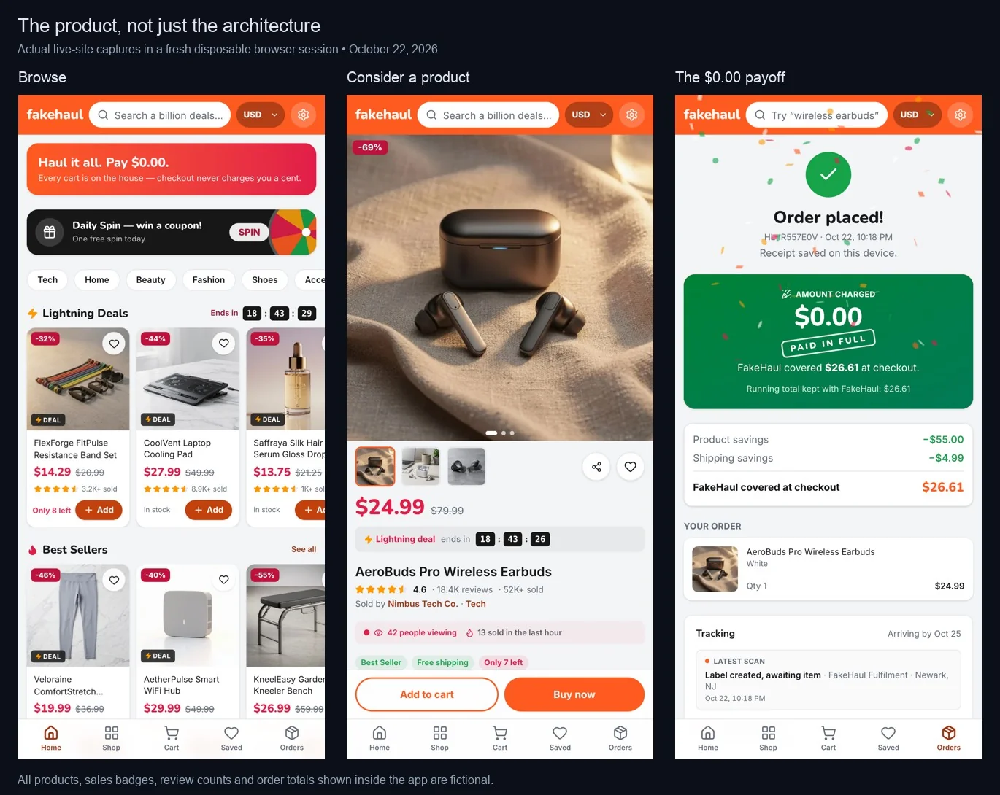
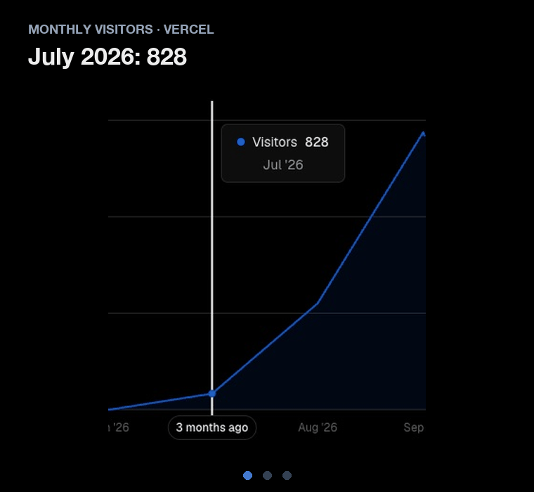
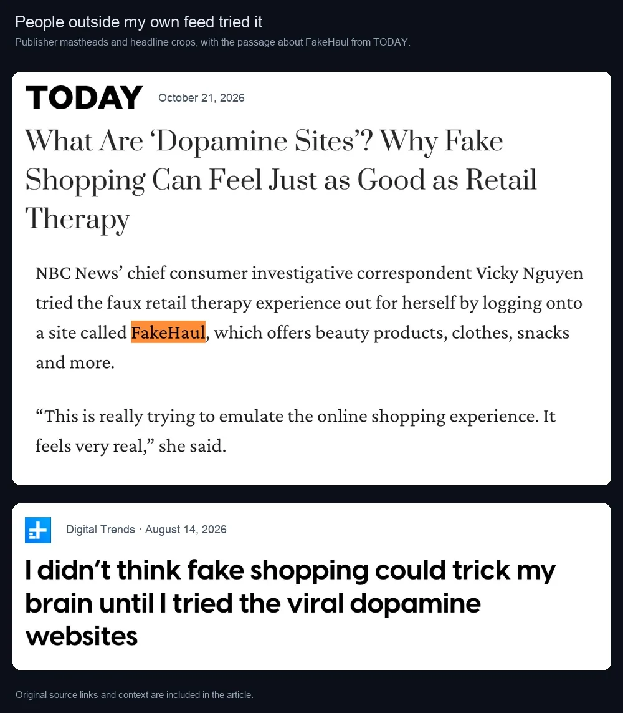
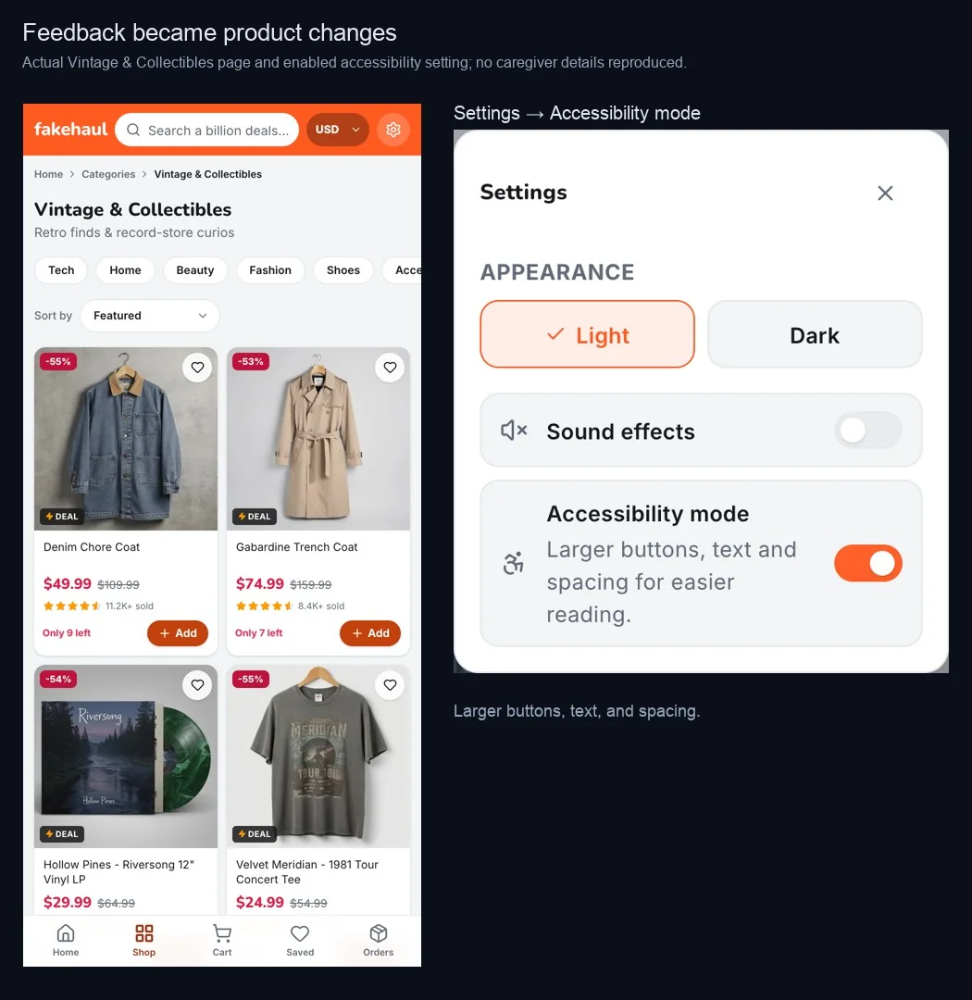

- **What:** a fake store with 1,800 fictional products where every checkout ends at $0.00
- **My role:** solo builder, from product and design to engineering and launch
- **Stack:** Next.js, React, Zustand, Sharp, FLUX.2-pro, Railway, Cloudflare
- **Results:** Monthly Visitors up 18x in two months (828 to 14,375), plus coverage from Fast Company, Digital Trends, BBC, and TODAY
- **Cost:** about $200 of AI to build, $5–10 a month to host
{:.note title="At a glance"}

I built FakeHaul on weekends, mostly with coding agents. The formula I'd bet on again: **agents write the code, a software factory makes the content, and my taste decides what ships.**



## Why a $0.00 store

You fill a cart, check out at $0.00, then get tracking, an unboxing, and a receipt for an order that never existed. I built it for someone close to me who struggled with impulse buying ([origin story](https://jackyangzzh.medium.com/i-built-a-fake-shopping-app-nothing-ships-it-might-be-the-most-useful-thing-ive-made-220919e6b6ce)). My hunch: let the ritual finish, minus the charge and the box. Accounts, ads, tracking, and monetization were off the table from day one. **A tool for people trying to stop buying can't be watching them shop.**

<figure>
  
  <figcaption>Live-site captures from October 22.</figcaption>
</figure>

Agents made every attempt cheap, so most of my work became deciding which attempts to keep. An early build announced the savings before checkout. I had the cart behave like a real one instead, with discounts and a shipping charge, because the $0.00 only lands if everything before it feels like paying. I also deleted a 306-line live delivery map the day I asked for it, since every package drove the same path. When an agent's review suggested removing the fake urgency and streaks, I kept them, because FakeHaul is a parody of exactly those mechanics.

## How I found out it was in the news

The [Product Hunt](https://www.producthunt.com/products/fakehaul) launch was quiet. Two weeks later, Vercel emailed me: FakeHaul was getting more traffic than my plan could handle. The usage dashboard showed visitors arriving from news sites: first [Fast Company](https://www.fastcompany.com/91577117/fake-temu-dopamine-site-gives-shoppers-a-boost-without-buying-anything-online-shopping-addiction), then [Digital Trends](https://www.digitaltrends.com/computing/i-tried-the-internets-weirdest-shopping-trend-and-my-brain-fell-for-it-more-than-i-expected/), the [BBC](https://www.bbc.com/news/articles/cwn741v5rdpxo), and [TODAY](https://www.today.com/life/fake-shopping-dopamine-sites-science-explained-rcna604753).

<figure>
  
  <figcaption>Monthly Visitors on Vercel, July to September 2026.</figcaption>
</figure>

<figure>
  
  <figcaption>Coverage from Fast Company, Digital Trends, BBC, and TODAY.</figcaption>
</figure>

## Agents wrote the code. I made the calls.

I split the work by model. Claude Opus and OpenAI's Astra planned and reviewed; cheaper models like DeepSeek and GLM implemented, which kept the build to about $200. Context lived in repo files, and with autodeploy on, my approval came before the push. Today Hermes Agent hands each tool a bounded task and checks the evidence (diffs, tests, renders) before I keep, change, or revert.



One example: I asked Claude Code to make the shareable receipt image match the redesigned receipt screen. While comparing them, it found the same earbuds cost $24.99 on screen and $79.99 in the image. The agent caught the bug; I noticed something felt off.



## The AI runs before anyone visits

My rule since July: all AI generation happens offline. Scripts write the catalog, reviews, and images before deploy, so browsing never calls an LLM. Carts and orders live in the browser's localStorage, with no account and no database of what anyone "bought."



## The software factory

Nobody hand-writes 1,800 listings, so I built a factory: models generate in bulk, scripts check and assemble, and I review what ships. That review is where taste lives: a schema check can validate a rating, but it can't tell you whether a review has a voice. When a batch of 200 products came back samey, I pushed back and committed 175 after rewrites.

Images ran on FLUX.2-pro: each product's hero shot first, then every other angle as an edit of it, so the product stays consistent and calls stay cheap.



Reviews are model-written once, offline: six workers, up to five attempts each, and a sanitizer that clamps ratings and drops any review naming a real brand. The result is 15,104 reviews in 64 server-only shards. Q&A mostly isn't a model at all. Question pools are seeded from the product ID, so a listing shows the same thread on every visit.



## Moving to Railway to keep it free

FakeHaul makes no money, and the Vercel bill climbed with the traffic. Codex ran the migration from a spec, not "move it off Vercel": keep the domain so saved carts survive, bundle Sharp and fonts, and keep the DNS switch separate from billing. Agents rarely fail at the work; they fail at the parts you didn't write down.

Hosting dropped from $40 a month to about $5–10, which at 15,000 to 40,000 visits a month is well under a tenth of a cent per visit. Because the AI runs before deploy, more traffic never means more AI spend.



## Trade-offs and lessons

- **Offline AI over live AI.** Generation is paid once, and pages never wait on a model.
- **Edits over fresh generations.** One hero image keeps every angle consistent, and it's cheaper.
- **Browser storage over accounts.** Privacy by default, at the cost of sync.
- **A plain container over edge functions.** Cloudflare Workers couldn't run Sharp. Railway could.

Next time, I'd **set up usage alerts before launch**, **plan the hosting exit before the traffic arrives**, and **design a privacy-safe way to learn whether it helps**, like an optional, anonymous check-in.

## What's next

In September, a caregiver shared FakeHaul on r/dementia, where a store that can't charge a card gave repeat ordering somewhere safe to go. I [joined the thread](https://www.reddit.com/r/dementia/comments/1wg6ez9/comment/pa3tfcv/?context=3), and shipped the bigger buttons and vintage section caregivers asked for, plus an accessibility mode.

<figure>
  
  <figcaption>Vintage &amp; Collectibles and accessibility mode.</figcaption>
</figure>

**FakeHaul isn't a care tool, and it's never been tested with people living with dementia.** I still don't know whether a fake checkout helps an urge pass or keeps the habit going. If people tell me it's making things worse, I'll take it down.
{:.note title="What I don't know yet"}

*[Try FakeHaul](https://fakehaul.com/), and send your best fake product ideas to [@jackyang on X](https://x.com/jackyang).*

## Press coverage

Coverage started in July 2026, during a wider conversation about "dopamine sites" that simulate consumption without selling anything, and it continued into October.

  <a href="https://www.nytimes.com/2026/09/11/world/asia/dopamine-sites-popularity.html" class="press-quote-card no-mark-external" target="_blank" rel="noopener noreferrer">
    The New York Times
    Placed FakeHaul within the trend and traced the idea back to the friend I built it for.
    Read article ↗
  </a>
  <a href="https://www.bbc.com/news/articles/cwn741v5rdpxo" class="press-quote-card no-mark-external" target="_blank" rel="noopener noreferrer">
    BBC
    Cited FakeHaul among the sites carrying the trend internationally and examined the psychology of anticipation versus ownership.
    Read article ↗
  </a>
  <a href="https://www.fastcompany.com/91577117/fake-temu-dopamine-site-gives-shoppers-a-boost-without-buying-anything-online-shopping-addiction" class="press-quote-card no-mark-external" target="_blank" rel="noopener noreferrer">
    Fast Company
    Questioned whether keeping habit-forming mechanics could undermine the idea.
    Read article ↗
  </a>

Additional coverage and commentary:

- [MarketWatch](https://www.marketwatch.com/story/fake-shopping-sprees-and-happiness-insurance-the-latest-fintech-apps-reveal-our-financial-anxieties-77770a46) looked at simulated shopping sprees alongside new consumer finance apps shaped by spending fatigue and financial anxiety.
- [Digital Trends](https://www.digitaltrends.com/computing/i-tried-the-internets-weirdest-shopping-trend-and-my-brain-fell-for-it-more-than-i-expected/) described feeling urgency from a countdown on a product that didn't exist, and questioned the impulse loops behind it.
- [NPR's Planet Money](https://www.npr.org/sections/planet-money/2026/09/25/nx-s1-5980393/why-this-pokemon-set-is-dropping-in-value) included it in a newsletter roundup of sites that simulate online shopping, alongside FoodNeverComes and ImaginAir.
- [Vice](https://www.vice.com/en/article/the-internet-has-invented-fake-online-shopping-and-theres-a-wild-reason-why-people-love-it/) described it as a way to "experience the thrilling ritual of buying a thing that doesn't exist."
- [CBC Radio's The Current](https://www.cbc.ca/radio/thecurrent/fake-shopping-website-app-dopamine-9.7313588) covered it among the mock shopping sites spreading beyond South Korea.
- [Futurism](https://futurism.com/future-society/bizarre-websites-dopamine-brain) called it a dopamine site that "convincingly imitates shopping on Temu."
- [Money Talks News](https://www.moneytalksnews.com/the-free-fake-shopping-sites-designed-to-cure-your-spending-and-the-catch-nobody-mentions/) called it "the biggest U.S. entry" in the trend and focused on its guardrails, including my plan to shut it down if the evidence turns against it.
- [Newser](https://www.newser.com/story/393338/site-lets-you-gleefully-shop-without-spending-money.html) focused on how completely the catalog is invented.
- [t3n](https://t3n.de/news/fake-shop-bestellung-dopamin-1749518/) read it as a parody of online retail mechanics.
- [Cybernews](https://cybernews.com/tech/digital-diy-ai-projects/) explored what AI makes possible for personal projects. We also discussed my choice not to collect accounts, email addresses, or IP-based tracking data. That leaves me without retention data, a trade-off I'm comfortable with.
- [The Cool Down](https://www.thecooldown.com/green-tech/dopamine-sites-south-korea-shopping-trend/) looked at shopping without spending, with the caveat that redirecting a habit isn't the same as resolving it.
- [Gizbot](https://www.gizbot.com/features/dopamine-sites-fake-food-delivery-foodnevercomes-128777.html) in India and [Oti Simveni](https://otisimveni.gr/2026/07/27/fakehaul-ti-einai-to-pseftiko-temu-opou-psonizeis-choris-na-agorazeis-tipota/) in Greece wrote it up for readers abroad.
